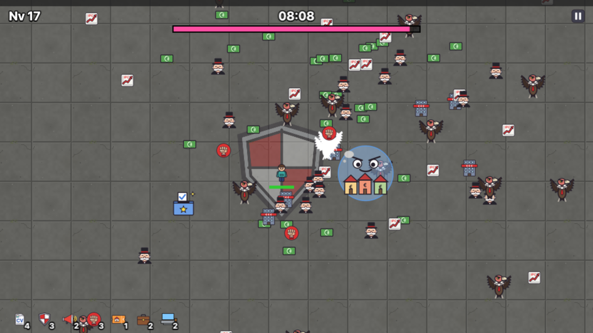

# 🏠 Vivienda Survivors

[](https://viviendasurvivors.es/)

> Tienes 30 años, buscas piso y te persigue el mercado inmobiliario.
> Aguanta **10 minutos** y conseguirás… firmar una hipoteca a 40 años.

Clon minimalista de *Vampire Survivors* y sátira (genérica) sobre la crisis de la vivienda. Hecho con **Phaser 3 + TypeScript + Vite**, sin backend.



## 🎮 Cómo se juega
- **Moverse:** WASD / flechas, o joystick táctil tocando la mitad inferior de la pantalla.
- **Atacar:** no hace falta, tus armas disparan solas.
- **Subir de nivel:** recoge 💶 y elige 1 de 3 mejoras (clic, tap o `1` `2` `3`).
- **Promesas electorales 🗳️:** cada 2 minutos. ¿Se cumplirá? Spoiler: probablemente no.
- **Pausa:** `Esc` / `P` o el botón ⏸.
- **Leyenda:** botón ❓ (o tecla `H`): pausa y muestra armas, pasivas, evoluciones (con su receta) y peligros.
- **Compartir:** al acabar la partida, "📤 Compartir" crea una imagen con la captura de tu final y tu resultado (menú nativo en móvil; en escritorio se copia al portapapeles o se descarga).
- **Sonido:** botón 🔊/🔇 junto a la pausa, o la tecla `M`. Se recuerda entre partidas.
- **Idioma:** inglés o español, se elige en el menú principal.
- **Móvil:** se juega en horizontal y a pantalla completa; se puede instalar como app.

## ⚔️ Armas (máx. nivel 5)
| Arma | Qué hace |
|---|---|
| 📄 **Lanzador de currículums** | Arma inicial. Dispara al enemigo más cercano; con nivel lanza más currículums y atraviesan enemigos. |
| 🛡️ **Escudo Ley de Vivienda** | Aura permanente que daña a todo lo que esté cerca de ti. Más radio y daño por nivel. |
| 📢 **¡Eso es un trastero!** | Grito periódico: explosión en área que daña y empuja a los enemigos. |
| ✊ **Sindicato de inquilinos** | Puños que orbitan a tu alrededor y golpean al pasar. Más puños por nivel. |

### ⭐ Evoluciones
Con un arma a nivel 5 y su pasiva emparejada, el siguiente menú de mejoras ofrece su evolución (tarjeta dorada «¡EVOLUCIÓN!»):

| Arma + pasiva | Evolución |
|---|---|
| 📄 Currículums + 💼 Segundo trabajo | 📇 **LinkedIn Premium**: dispara en 8 direcciones, atraviesa a todos, +50% daño. |
| 🛡️ Escudo + 👴 Aval de tus padres | 🏰 **Escudo Antidesahucios**: radio +60%, +50% daño y te cura al matar (máx. 5 HP/s). |
| 📢 Grito + 🛏️ Piso compartido | 📣 **Manifestación**: radio ×2, empuje fuerte; cada 5.ª explosión llena la pantalla. |
| ✊ Sindicato + 🎫 Bono Alquiler Joven | 👊 **Huelga general**: 8 puños más grandes, órbita +50%, +60% daño. |

### 👑 Enemigos premium y cofres
Cada minuto (desde el 1:00, salvo con el boss vivo) aparece un enemigo **premium**: dorado, más grande, con corona y una flecha que te dice dónde está. Al morir suelta un 🏠 **Piso de protección oficial**: tócalo y te da 1, 3 o 5 mejoras automáticas (primero una evolución si la tienes disponible, luego tus armas por debajo de nivel 5).

## 🧩 Mejoras pasivas (máx. nivel 5)
| Pasiva | Efecto por nivel |
|---|---|
| 👴 **Aval de tus padres** | +20 vida máxima (y cura 20) |
| 🛏️ **Piso compartido** | −8% tiempo de recarga de todas las armas |
| 🎫 **Bono Alquiler Joven** | +15% radio para recoger 💶 y +5% velocidad |
| 💼 **Segundo trabajo** | +10% daño de todas las armas |
| 💻 **Teletrabajo** | Regenera +0,3 de vida por segundo |
| 🍺 **Caña con los colegas** | Cura 30. Aparece cuando ya no quedan otras mejoras; con todo al máximo se aplica sola (sin menú) y cada nivel pide el doble de 💶. |

## 🗳️ Promesas electorales
Aparece una urna en los minutos 2, 4, 6 y 8: se avisa en pantalla y una flecha indica dónde. Al cogerla se elige una promesa al azar y tienes un **buff de 20 s**; arriba verás qué ganas, qué pasaría si se incumple y la cuenta atrás *«¿Se cumplirá?»*. Al acabar, al 50%: se cumple (el buff termina sin más) o se incumple y sufres un **debuff de 15 s**.

| Promesa | Buff | Si se incumple |
|---|---|---|
| ¡Un millón de viviendas públicas! | Daño ×2 | Daño ×0,6 |
| ¡Bajaremos el alquiler por decreto! | Enemigos a mitad de velocidad | Enemigos ×1,3 más rápidos |
| ¡Ayudas directas a la juventud! | Imán ×4 y XP ×2 | XP ×0,5 |
| ¡Acabaremos con la especulación! | Recargas ×0,5 | Recargas ×1,5 |
| ¡Vivienda digna para todos! | Invulnerable | Te mueves ×0,6 |

## 👾 Enemigos
| Enemigo | Aparece | Cómo es |
|---|---|---|
| 📈 **Subida del IPC** | 00:00 | Débil y numeroso. |
| 🤑 **Casero de contrato de 11 meses** | 01:00 | Lento pero aguanta. |
| 🏢 **Agencia con honorarios** | 02:00 | Rápida. En el **05:00** llega la *temporada turística*: 40 agencias te rodean. |
| 🦅 **Fondo buitre** | 04:00 | Grande, duro y pega fuerte. Cada vez hay más. |
| 🫧 **Burbuja 2.0** (boss) | 08:00 | 8000 de vida (más cuantas más evoluciones tengas); cada 3 s dispara un anillo de 12 💸. Se avisa 3 s antes. No hace falta matarla para ganar. |
| 🚀 **Euríbor disparado** | 03:00 | Indestructible: solo se esquiva. Un "!" rojo avisa por qué borde entra; cruza la pantalla hacia ti. Cada vez salen más y más seguido. |

Cada enemigo nuevo se presenta con un cartel la primera vez que aparece.

Los enemigos se hacen más resistentes y pegan más fuerte cada minuto (y aún más resistentes con cada evolución). Aguanta hasta el **10:00** para ganar… y si caes antes, también hay animación de derrota.

## 🛠️ Desarrollo
```bash
npm install
npm run dev      # servidor local
npm run build    # build de producción en dist/
npm run zip      # zip listo para itch.io
```

Cada push a `main` se publica automáticamente en GitHub Pages (rama `gh-pages`) con el dominio propio `viviendasurvivors.es` ([`public/CNAME`](public/CNAME)).

Cada PR abierta desde este repositorio tiene su propia preview jugable en `https://viviendasurvivors.es/pr-preview/pr-<número>/`; el enlace aparece como comentario en la PR y la preview se borra al cerrarla. Las PR desde forks no generan preview.

Parámetros de URL para probar (las partidas con `min`, `win`, `evo`, `elite` o `missile` no guardan récord):
| Parámetro | Qué hace |
|---|---|
| `?min=N` | Empieza en el minuto `N` (0–9). |
| `?win=1` | Ganas nada más empezar, para ver la animación de victoria. |
| `?evo=1` | Empiezas con las 4 armas a nivel 5 y sus pasivas a nivel 1: las evoluciones salen en las primeras subidas. |
| `?elite=1` | Sale un enemigo premium a los 5 s y luego cada 20 s (para probar los cofres). |
| `?missile=1` | La primera tanda de Euríbor disparado sale a los 5 s. |
| `?debug=1` | Muestra las hitboxes de la física. |
| `?adtest=1` | Anuncios de prueba de AdSense (solo con `ADS.publisherId` puesto). |

## 💸 Anuncios (Google AdSense)
El juego es gratis y está preparado para **H5 Games Ads** de AdSense (API `adBreak`). Todo vive en [`src/systems/ads.ts`](src/systems/ads.ts) y se configura en `ADS` de [`src/config.ts`](src/config.ts):

| Campo | Qué hace |
|---|---|
| `publisherId` | Tu ID de editor (`'ca-pub-1234567890123456'`). **Vacío (por defecto): no se carga ningún script de anuncios ni de consentimiento** y el juego funciona como siempre. |
| `testMode` | `false` (por defecto): anuncios reales. **Déjalo así**: para ver anuncios de prueba (`data-adbreak-test="on"`) abre el juego con **`?adtest=1`** (p. ej. `https://viviendasurvivors.es/?adtest=1`); solo afecta a esa visita, así producción nunca sirve anuncios de prueba por despiste. |
| `interstitialMinGapSeconds` | Separación mínima entre anuncios (180 s). |
| `rewardStartTimeoutMs` | Tras pulsar "Ver anuncio para revivir", si el anuncio no empieza en este tiempo (8000 ms), cuenta como no visto y sigue la derrota. |

Con el ID puesto:
1. Se carga la CMP certificada de Google (Privacy & messaging) y, **solo cuando hay datos de consentimiento**, `adsbygoogle.js`. Configura el mensaje europeo en AdSense → *Privacidad y mensajes*. El menú muestra "Preferencias de privacidad" para reabrirlo.
2. **Intersticial** (`adBreak({type: 'next'})`) al pasar de Game Over a una partida nueva, como mucho uno cada `interstitialMinGapSeconds`. Nunca durante la partida ni antes de la primera.
3. **Revivir con anuncio** (`adBreak({type: 'reward'})`): al morir por primera vez en la partida, si hay un anuncio listo, aparece "Ver anuncio para revivir". Si se ve entero, sigues la misma partida con el 50% de vida y 5 s de invulnerabilidad (`REVIVE` en `config.ts`). Una vez por partida.
4. Mientras se ve un anuncio el juego se pausa y se silencia. Si los anuncios están bloqueados, fallan o no están listos, el juego sigue sin ellos.

Cuando AdSense apruebe el sitio, completa también [`public/ads.txt`](public/ads.txt) con tu línea `google.com, pub-…, DIRECT, f08c47fec0942fa0`.

La [guía](public/guia.html), la [política de privacidad](public/privacidad.html) y la página [Acerca de](public/acerca.html) (ES + EN) se enlazan desde el pie del menú.

## 📄 Contenido estático y buscadores
- [`index.html`](index.html) lleva bajo el juego una guía en HTML plano en español e inglés, más un `<noscript>` con un resumen, para que la portada tenga contenido legible sin JavaScript. En el menú y en Game Over el juego va en un marco con borde amarillo para que se vea que hay contenido debajo; durante la partida ocupa toda la pantalla.
- [`public/guia.html`](public/guia.html): guía completa (enemigos, armas, pasivas, evoluciones, promesas y consejos).
- [`public/robots.txt`](public/robots.txt) y [`public/sitemap.xml`](public/sitemap.xml) (portada, guía, acerca de y privacidad).
- **Si cambias el juego** (mecánicas, números o nombres), actualiza también `index.html` y `public/guia.html` para que digan lo mismo que el juego.

## 🎨 Cambiar el arte
Todo lo visible está en [`src/visuals.ts`](src/visuals.ts):
1. Pon tus PNG en `public/assets/`.
2. Añádelos a `CUSTOM_ART` (sprite, spritesheet animado o fondo).

`USE_CUSTOM_ART = true` (por defecto) usa los PNG; con `false` el juego usa solo emoji. Si una imagen falla, esa entidad vuelve a su emoji.

## 🔊 Cambiar el sonido
Todo el audio está en [`src/sounds.ts`](src/sounds.ts) (clave, ruta y volumen); los archivos van en `public/assets/sfx/` y `public/assets/music/`. Si uno falta, el juego sigue sin ese sonido.

Los efectos y la música son chiptune generado por código con [`tools/gen_sfx.py`](tools/gen_sfx.py) (numpy + ffmpeg), así que no hay derechos de terceros:
```bash
python3 tools/gen_sfx.py          # efectos; la música solo si no existe
python3 tools/gen_sfx.py --music  # regenera también la música
```

El diseño completo está en [`GDD.md`](GDD.md).
