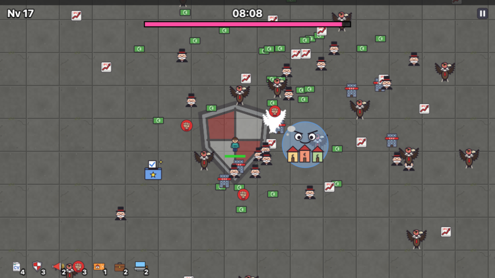

# 🏠 Vivienda Survivors

[](https://heikkidev.github.io/vivienda-survivors/)

> Tienes 30 años, buscas piso y te persigue el mercado inmobiliario.
> Aguanta **10 minutos** y conseguirás… firmar una hipoteca a 40 años.

Clon minimalista de *Vampire Survivors* y sátira (genérica) sobre la crisis de la vivienda. Hecho con **Phaser 3 + TypeScript + Vite**, sin backend.



## 🎮 Cómo se juega
- **Moverse:** WASD / flechas, o joystick táctil tocando la mitad inferior de la pantalla.
- **Atacar:** no hace falta, tus armas disparan solas.
- **Subir de nivel:** recoge 💶 y elige 1 de 3 mejoras (clic, tap o `1` `2` `3`).
- **Promesas electorales 🗳️:** cada 2 minutos. ¿Se cumplirá? Spoiler: probablemente no.
- **Pausa:** `Esc` / `P` o el botón ⏸.
- **Compartir:** al acabar la partida, "📤 Compartir" crea una imagen con la captura de tu final y tu resultado (menú nativo en móvil; en escritorio se copia al portapapeles o se descarga).
- **Sonido:** botón 🔊/🔇 junto a la pausa, o la tecla `M`. Se recuerda entre partidas.
- **Idioma:** inglés o español, se elige en el menú principal.
- **Móvil:** se juega en horizontal y a pantalla completa; se puede instalar como app.

## ⚔️ Armas (máx. nivel 5)
| Arma | Qué hace |
|---|---|
| 📄 **Lanzador de currículums** | Arma inicial. Dispara al enemigo más cercano; con nivel lanza más currículums y atraviesan enemigos. |
| 🛡️ **Escudo Ley de Vivienda** | Aura permanente que daña a todo lo que esté cerca de ti. Más radio y daño por nivel. |
| 📢 **¡Eso es un trastero!** | Grito periódico: explosión en área que daña y empuja a los enemigos. |
| ✊ **Sindicato de inquilinos** | Puños que orbitan a tu alrededor y golpean al pasar. Más puños por nivel. |

### ⭐ Evoluciones
Con un arma a nivel 5 y su pasiva emparejada, el siguiente menú de mejoras ofrece su evolución (tarjeta dorada «¡EVOLUCIÓN!»):

| Arma + pasiva | Evolución |
|---|---|
| 📄 Currículums + 💼 Segundo trabajo | 📇 **LinkedIn Premium**: dispara en 8 direcciones, atraviesa a todos, +50% daño. |
| 🛡️ Escudo + 👴 Aval de tus padres | 🏰 **Escudo Antidesahucios**: radio +60%, +50% daño y te cura al matar (máx. 5 HP/s). |
| 📢 Grito + 🛏️ Piso compartido | 📣 **Manifestación**: el doble de seguido, radio ×2, empuje fuerte; cada 3.ª explosión llena la pantalla. |
| ✊ Sindicato + 🎫 Bono Alquiler Joven | 👊 **Huelga general**: 8 puños más grandes, órbita +50%, +60% daño. |

## 🧩 Mejoras pasivas (máx. nivel 5)
| Pasiva | Efecto por nivel |
|---|---|
| 👴 **Aval de tus padres** | +20 vida máxima (y cura 20) |
| 🛏️ **Piso compartido** | −8% tiempo de recarga de todas las armas |
| 🎫 **Bono Alquiler Joven** | +15% radio para recoger 💶 y +5% velocidad |
| 💼 **Segundo trabajo** | +10% daño de todas las armas |
| 💻 **Teletrabajo** | Regenera +0,3 de vida por segundo |
| 🍺 **Caña con los colegas** | Cura 30. Aparece cuando ya no quedan otras mejoras. |

## 🗳️ Promesas electorales
Aparece una urna en los minutos 2, 4, 6 y 8: se avisa en pantalla y una flecha indica dónde. Al cogerla se elige una promesa al azar y tienes un **buff de 20 s**; arriba verás qué ganas, qué pasaría si se incumple y la cuenta atrás *«¿Se cumplirá?»*. Al acabar, al 50%: se cumple (el buff termina sin más) o se incumple y sufres un **debuff de 15 s**.

| Promesa | Buff | Si se incumple |
|---|---|---|
| ¡Un millón de viviendas públicas! | Daño ×2 | Daño ×0,6 |
| ¡Bajaremos el alquiler por decreto! | Enemigos a mitad de velocidad | Enemigos ×1,3 más rápidos |
| ¡Ayudas directas a la juventud! | Imán ×4 y XP ×2 | XP ×0,5 |
| ¡Acabaremos con la especulación! | Recargas ×0,5 | Recargas ×1,5 |
| ¡Vivienda digna para todos! | Invulnerable | Te mueves ×0,6 |

## 👾 Enemigos
| Enemigo | Aparece | Cómo es |
|---|---|---|
| 📈 **Subida del IPC** | 00:00 | Débil y numeroso. |
| 🤑 **Casero de contrato de 11 meses** | 01:00 | Lento pero aguanta. |
| 🏢 **Agencia con honorarios** | 02:00 | Rápida. En el **05:00** llega la *temporada turística*: 40 agencias te rodean. |
| 🦅 **Fondo buitre** | 04:00 | Grande, duro y pega fuerte. Cada vez hay más. |
| 🫧 **Burbuja 2.0** (boss) | 08:00 | 3000 de vida; cada 5 s dispara un anillo de 💸. Se avisa 3 s antes. No hace falta matarla para ganar. |

Cada enemigo nuevo se presenta con un cartel la primera vez que aparece.

Los enemigos se hacen más resistentes cada minuto. Aguanta hasta el **10:00** para ganar… y si caes antes, también hay animación de derrota.

## 🛠️ Desarrollo
```bash
npm install
npm run dev      # servidor local
npm run build    # build de producción en dist/
npm run zip      # zip listo para itch.io
```

Cada push a `main` se publica automáticamente en GitHub Pages.

Parámetros de URL para probar (las partidas con `min`, `win` o `evo` no guardan récord):
| Parámetro | Qué hace |
|---|---|
| `?min=N` | Empieza en el minuto `N` (0–9). |
| `?win=1` | Ganas nada más empezar, para ver la animación de victoria. |
| `?evo=1` | Empiezas con las 4 armas a nivel 5 y sus pasivas a nivel 1: las evoluciones salen en las primeras subidas. |
| `?debug=1` | Muestra las hitboxes de la física. |

## 🎨 Cambiar el arte
Todo lo visible está en [`src/visuals.ts`](src/visuals.ts):
1. Pon tus PNG en `public/assets/`.
2. Añádelos a `CUSTOM_ART` (sprite, spritesheet animado o fondo).

`USE_CUSTOM_ART = true` (por defecto) usa los PNG; con `false` el juego usa solo emoji. Si una imagen falla, esa entidad vuelve a su emoji.

## 🔊 Cambiar el sonido
Todo el audio está en [`src/sounds.ts`](src/sounds.ts) (clave, ruta y volumen); los archivos van en `public/assets/sfx/` y `public/assets/music/`. Si uno falta, el juego sigue sin ese sonido.

Los efectos y la música son chiptune generado por código con [`tools/gen_sfx.py`](tools/gen_sfx.py) (numpy + ffmpeg), así que no hay derechos de terceros:
```bash
python3 tools/gen_sfx.py          # efectos; la música solo si no existe
python3 tools/gen_sfx.py --music  # regenera también la música
```

El diseño completo está en [`GDD.md`](GDD.md).
